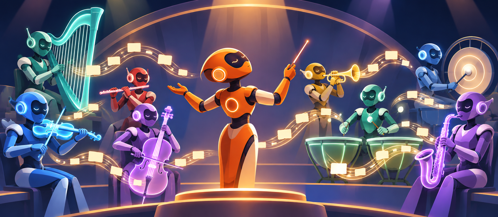
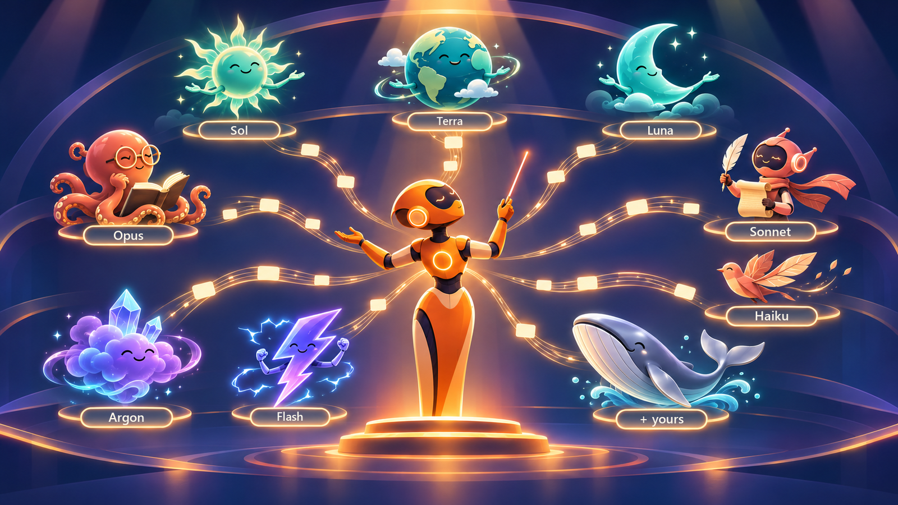
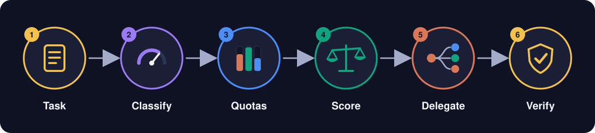
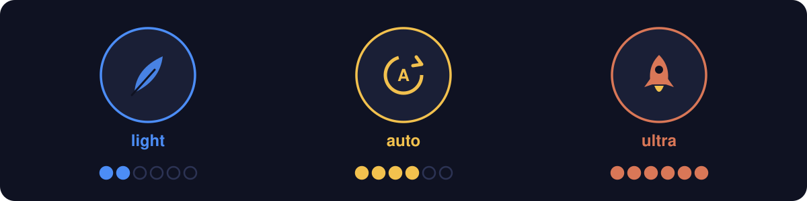
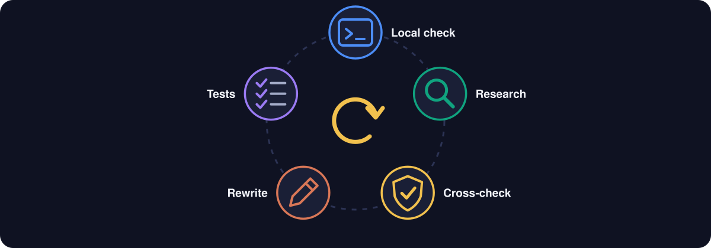
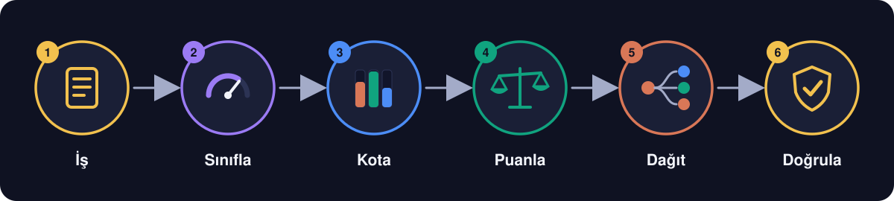
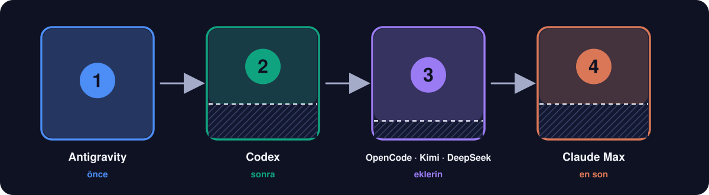
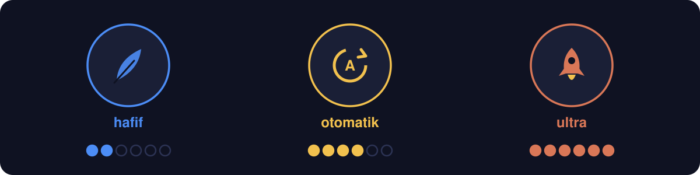
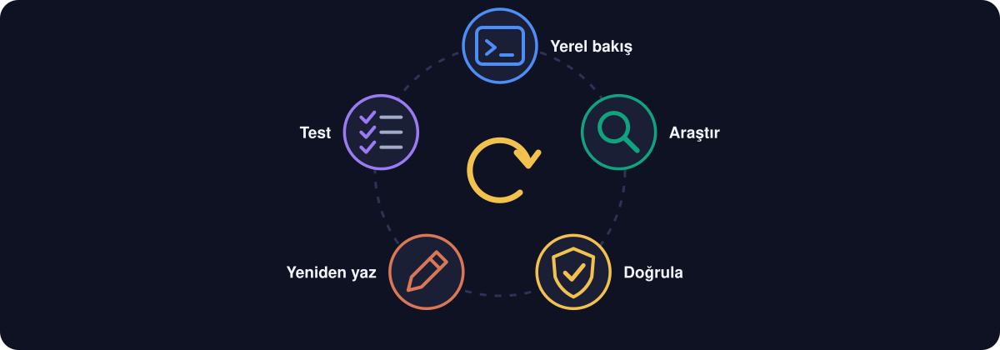

<div align="center">

# 🎼 Orkestra

**Your AI subscriptions, playing as one orchestra.**<br>
**Yapay zekâ aboneliklerin, tek bir orkestra gibi çalışsın.**

[](#-english)
[](#-türkçe)
[](https://github.com/yigityildiz0/orkestra/archive/refs/heads/main.zip)
[](https://github.com/yigityildiz0/orkestra/releases/latest)

[](#-english)
[](#-english)
[](#-english)
[](#-english)




</div>

---

## 🇬🇧 English

### The idea in 30 seconds

You pay for ChatGPT Plus. Maybe Claude too, maybe Google AI Pro. Each one has its own limits that refill every
5 hours or every week, and they are not equal: 5% of one plan is not 5% of another. Most people use one until it
runs dry, while the others sit idle.

**Orkestra turns your main AI into a conductor.** Before each piece of work it looks at how hard the job is and how
much room each subscription has left. Then it hands the job to the model that is **smart enough, but not wasteful**,
on the platform that can best afford it. A different model family checks the result. Reading the limits costs
**zero tokens**.

> **Start with just Codex.** If ChatGPT Plus is all you have, Orkestra still picks Sol, Terra or Luna and the
> right effort for each job, and keeps a weekly reserve. Add Claude, Antigravity, OpenCode or anything else later.

### 🎻 Meet the orchestra



Think of a restaurant kitchen. The head chef does not cook every dish: easy ones go to a junior cook, hard ones
to the best cook who is free right now, and someone else tastes the plate before it leaves. Orkestra is that head
chef for your AI subscriptions. The models are the cooks; their limits are their working hours.

### ⚡ Install in one minute: let your AI do it

1. Copy the message below.
2. Fill in the blanks with what you have.
3. Paste it into **Codex, Claude Code, OpenCode or Antigravity**. It reads [`INSTALL.md`](INSTALL.md), finds what is
   really installed, fixes what is broken, and sets everything up. It asks before anything that costs money or quota.

```text
Install Orkestra from https://github.com/yigityildiz0/orkestra
Read INSTALL.md in that repository and follow it step by step.

My AI platforms (write yes / no / not sure):
- ChatGPT Plus or Pro, Codex CLI: ____
- Claude Code (Claude Pro or Max): ____
- Google Antigravity (Google AI Pro): ____
- OpenCode (Go plan or other): ____
- Other CLIs (Kimi, DeepSeek, Qwen, ...): ____

Check what is really installed, fix problems, never use paid extras,
then show me /orkestra status and explain how to use it.
```

<details>
<summary><b>Prefer to do it by hand?</b></summary>

1. [Download the ZIP](https://github.com/yigityildiz0/orkestra/archive/refs/heads/main.zip) and unzip it.
2. Copy `skills/orkestra` into your tool's skills folder, for example `~/.claude/skills/orkestra` or `~/.codex/skills/orkestra`.
3. Copy `examples/platformlar.example.json` to `~/.orkestra/platformlar.json` and edit it to match your platforms.
4. Check: `python -I skills/orkestra/scripts/kapasite.py kontrol` should print only PASS lines.

</details>

### 🎯 How a task is routed



1. **Task**: you type `/orkestra fix the login bug`, or just work while orchestration is on.
2. **Classify**: how smart must the worker be? Mechanical, simple, research, normal, code, hard or critical.
3. **Quotas**: Codex and Antigravity limits are read locally, Claude's from the app. No model is called.
4. **Score**: every model × effort pair is scored by intelligence, the real work left in each window, your pace this
   week and how expendable that platform is. A model that is too weak is dropped; a big model for a tiny job is penalised.
5. **Delegate**: the winner gets a short, precise brief. Independent pieces run in parallel.
6. **Verify**: a different model family checks the result before you see it.

### 🪫 Spend order


The coloured part of each tank is what Orkestra may spend; the hatched part is a reserve it never touches (defaults:
Antigravity 5%, Codex 30%, Claude 30% weekly). When a Claude model and a GPT model are close in intelligence
(GPT Sol ≈ Claude Sonnet), the GPT one wins, so your Claude limit lasts. Images go to ChatGPT's image tool whenever Codex has room:
the best-rated image model you can reach without an API key.
See Claude work live while it does: [Claude Office](https://github.com/yigityildiz0/claude-pixel-office), the sister project.

### ⚙️ Three gears



| Gear | When | What changes |
|---|---|---|
| `light` | `/orkestra light …` or Claude is running low | cheapest model that is still smart enough, up to 2 workers |
| `auto` | default | Orkestra picks: light when Claude is short, ultra only for critical work |
| `ultra` | `/orkestra ultra …` | one tier smarter, verification from another family, up to 6 workers |

You can always just say it: *"run 4 agents"*, *"use Codex for this"*, *"don't touch Claude"*.

### 🔄 It keeps itself up to date



`/orkestra update` checks which models your CLIs really offer, researches prices, token use, effort curves,
abilities (image, video, audio) and strengths and weaknesses, has every important claim re-checked by a sceptical
agent, rewrites the model atlas and the selector, and runs the rule tests. Run it monthly or when a new model ships.

### Commands

| Type this | It does |
|---|---|
| `/orkestra` | show remaining quota and the best model for each kind of work |
| `/orkestra <task>` | do the task the orchestrated way |
| `/orkestra light <task>` / `/orkestra ultra <task>` | same, in a fixed gear |
| `/orkestra on` / `/orkestra off` | orchestrate every substantial task in this session, or stop |
| `/orkestra update` | refresh the model knowledge (see above) |
| `/orkestra why <model> <class>` | explain why a model was chosen or dropped |

### What works with what

| Platform | Leader | Workers | Quota read | Notes |
|---|---|---|---|---|
| Codex CLI (ChatGPT Plus/Pro) | ✅ | ✅ | automatic | image generation lives here |
| Claude Code (Pro/Max) | ✅ | ✅ | desktop app or `/usage` | protected, spent last |
| Antigravity `agy` (Google AI Pro) | ✅ | ✅ | automatic | Gemini plus its own Claude pool; video understanding in interactive mode |
| OpenCode and other headless CLIs | ✅ | ✅ | you give a rough % | add them in `platformlar.json` |

Video generation has no automatic route on these subscriptions today; Orkestra says so and tells you the manual route.

### FAQ

<details><summary><b>Does it cost anything extra?</b></summary>
No. It only uses subscriptions you already have, through their own CLIs. No API keys, no paid add-ons.
</details>
<details><summary><b>Does checking limits use tokens?</b></summary>
No. Codex and Antigravity report their counters locally; the result is cached for 10 minutes.
</details>
<details><summary><b>Can I force a model?</b></summary>
Yes. Say it, or add a project rule file <code>.orkestra.json</code>. Your words beat every default.
</details>
<details><summary><b>How accurate are the numbers?</b></summary>
Intelligence scores and prices come from public benchmarks (dated in the atlas). Quota costs start as estimates and
calibrate themselves with <code>olc</code> measurements. <code>/orkestra update</code> refreshes everything.
</details>
<details><summary><b>Why are the script's labels Turkish?</b></summary>
The helper scripts are read by your AI, not by you, and Orkestra was born in Turkish. Your AI answers in your language.
</details>

### 🆓 Free to use, change and share

Orkestra is [MIT licensed](LICENSE): use it at home or at work, change it, ship it in your own project, even
sell something built on it. Just keep the license file. Found a better routing rule or a new platform?
[Open an issue or a pull request](CONTRIBUTING.md). If it saves you limits, a ⭐ helps others find it.

<sub>Claude, ChatGPT, Codex, Gemini, Antigravity, OpenCode, Kimi and DeepSeek are trademarks of their owners.
Orkestra is an independent community project, not made or endorsed by any of them. The model characters in the
pictures are original illustrations, not official logos.</sub>

---

## 🇹🇷 Türkçe

### 30 saniyede fikir

ChatGPT Plus'a para ödüyorsun. Belki Claude'a da, belki Google AI Pro'ya da. Her birinin 5 saatte ya da haftada bir
dolan kendi limiti var ve bunlar eşit değil: birinin %5'i ötekinin %5'i değil. Çoğu kişi birini bitene kadar
kullanır, diğerleri boşta bekler.

**Orkestra, ana yapay zekânı bir şefe dönüştürür.** Her işten önce işin ne kadar zor olduğuna ve hangi aboneliğin ne
kadar yeri kaldığına bakar. İşi, **yeterince zeki ama israf etmeyen** modele, bunu en rahat karşılayabilecek
platformda verir. Sonucu başka bir model ailesi kontrol eder. Limitleri okumak **sıfır token** harcar.

> **Sadece Codex ile başla.** Elinde yalnız ChatGPT Plus varsa Orkestra yine her iş için Sol, Terra ya da Luna'yı ve
> doğru eforu seçer, haftalık yedek bırakır. Claude, Antigravity, OpenCode ya da başka platformları sonra eklersin.

### 🎻 Orkestrayla tanış


Bir restoran mutfağı düşün. Şef her yemeği kendisi pişirmez: kolay tabak çırağa, zor tabak o an boşta olan en
iyi aşçıya gider ve tabak çıkmadan önce başka biri tadına bakar. Orkestra, yapay zekâ aboneliklerinin şefidir.
Modeller aşçılar, limitleri de mesai saatleridir.

### ⚡ Bir dakikada kurulum: yapay zekân yapsın

1. Aşağıdaki mesajı kopyala.
2. Boşlukları elindekilerle doldur.
3. **Codex, Claude Code, OpenCode ya da Antigravity**'ye yapıştır. [`INSTALL.md`](INSTALL.md) dosyasını okur, neyin
   gerçekten kurulu olduğunu bulur, bozukları düzeltir ve her şeyi ayarlar. Para ya da kota harcayacak her şeyden önce sorar.

```text
https://github.com/yigityildiz0/orkestra adresindeki Orkestra'yı kur.
O depodaki INSTALL.md dosyasını oku ve adım adım uygula.

Yapay zekâ platformlarım (evet / hayır / emin değilim yaz):
- ChatGPT Plus veya Pro, Codex CLI: ____
- Claude Code (Claude Pro veya Max): ____
- Google Antigravity (Google AI Pro): ____
- OpenCode (Go planı veya başka): ____
- Diğer CLI'lar (Kimi, DeepSeek, Qwen, ...): ____

Gerçekte neyin kurulu olduğunu kontrol et, sorunları düzelt, ücretli ek kullanma,
sonra bana /orkestra durumunu göster ve nasıl kullanacağımı Türkçe anlat.
```

<details>
<summary><b>Elle kurmak mı istersin?</b></summary>

1. [ZIP'i indir](https://github.com/yigityildiz0/orkestra/archive/refs/heads/main.zip) ve aç.
2. `skills/orkestra` klasörünü aracının skill klasörüne kopyala; örneğin `~/.claude/skills/orkestra` veya `~/.codex/skills/orkestra`.
3. `examples/platformlar.example.json` dosyasını `~/.orkestra/platformlar.json` olarak kopyala ve platformlarına göre düzenle.
4. Kontrol: `python -I skills/orkestra/scripts/kapasite.py kontrol` yalnız PASS satırları basmalı.

</details>

### 🎯 Bir iş nasıl yönlenir



1. **İş**: `/orkestra giriş hatasını düzelt` yazarsın ya da orkestra açıkken normal çalışırsın.
2. **Sınıfla**: işçi ne kadar zeki olmalı? Mekanik, basit, araştırma, normal, kod, zor ya da kritik.
3. **Kota**: Codex ve Antigravity limitleri yerelden, Claude'unki uygulamadan okunur. Hiçbir model çağrılmaz.
4. **Puanla**: her model × efor ikilisi zekâya, her penceredeki gerçek kalan işe, bu haftaki temponla ve o platformun
   ne kadar harcanabilir olduğuna göre puanlanır. Zayıf kalan model elenir; küçük işe büyük model ceza alır.
5. **Dağıt**: kazanana kısa ve net bir görev tanımı gider. Bağımsız parçalar paralel çalışır.
6. **Doğrula**: sonuç sana gelmeden başka bir model ailesi kontrol eder.

### 🪫 Harcama sırası



Her tankın renkli kısmı Orkestra'nın harcayabileceği, taralı kısmı hiç dokunmadığı yedektir (varsayılan haftalık:
Antigravity %5, Codex %30, Claude %30). Bir Claude modeli ile bir GPT modeli zekâda yakınsa (GPT Sol ≈ Claude
Sonnet) GPT seçilir, böylece Claude limitin uzun dayanır. Codex'te yer oldukça görseller ChatGPT'nin görsel aracına gider:
API anahtarı olmadan ulaşabildiğin en yüksek puanlı görsel modeli.

### ⚙️ Üç vites



| Vites | Ne zaman | Ne değişir |
|---|---|---|
| `hafif` | `/orkestra hafif …` ya da Claude azalınca | hâlâ yeterince zeki en ucuz model, en çok 2 işçi |
| `otomatik` | varsayılan | Orkestra seçer: Claude kıtsa hafif, ultra yalnız kritik işte |
| `ultra` | `/orkestra ultra …` | bir kademe akıllı, başka aileden doğrulama, en çok 6 işçi |

İstediğin zaman söyleyebilirsin: *"4 ajan çalıştır"*, *"bunu Codex'e yaptır"*, *"Claude'a dokunma"*.

### 🔄 Kendini güncel tutar



`/orkestra güncelle`, CLI'larının gerçekte hangi modelleri sunduğuna bakar; fiyatı, token kullanımını, efor eğrilerini,
yetenekleri (görsel, video, ses), güçlü ve zayıf yanları araştırır, her önemli iddiayı şüpheci bir ajana yeniden
kontrol ettirir, model atlasını ve seçiciyi yeniden yazar ve kural testlerini çalıştırır. Ayda bir ya da yeni model
çıkınca çalıştır.

### Komutlar

| Yaz | Ne yapar |
|---|---|
| `/orkestra` | kalan kotayı ve her iş türü için en iyi modeli gösterir |
| `/orkestra <iş>` | işi orkestra yöntemiyle yapar |
| `/orkestra hafif <iş>` / `/orkestra ultra <iş>` | aynısı, sabit viteste |
| `/orkestra aç` / `/orkestra kapat` | bu oturumda her esaslı işi orkestrayla yürütür ya da bırakır |
| `/orkestra güncelle` | model bilgisini yeniler (yukarıda) |
| `/orkestra neden <model> <sınıf>` | bir modelin neden seçildiğini ya da elendiğini açıklar |

### Ne neyle çalışır

| Platform | Lider | İşçi | Kota okuma | Not |
|---|---|---|---|---|
| Codex CLI (ChatGPT Plus/Pro) | ✅ | ✅ | otomatik | görsel üretim burada |
| Claude Code (Pro/Max) | ✅ | ✅ | masaüstü uygulaması ya da `/usage` | korunur, en son harcanır |
| Antigravity `agy` (Google AI Pro) | ✅ | ✅ | otomatik | Gemini ve kendi Claude havuzu; video anlama etkileşimli modda |
| OpenCode ve diğer CLI'lar | ✅ | ✅ | yaklaşık % sen verirsin | `platformlar.json` ile eklenir |

Bu aboneliklerle bugün video üretiminin otomatik yolu yok; Orkestra bunu açıkça söyler ve el ile yolu gösterir.

### SSS

<details><summary><b>Ek bir ücreti var mı?</b></summary>
Hayır. Yalnız zaten sahip olduğun abonelikleri kendi CLI'larıyla kullanır. API anahtarı yok, ücretli eklenti yok.
</details>
<details><summary><b>Limit kontrolü token harcar mı?</b></summary>
Hayır. Codex ve Antigravity sayaçlarını yerelden bildirir; sonuç 10 dakika saklanır.
</details>
<details><summary><b>Bir modeli zorlayabilir miyim?</b></summary>
Evet. Söylemen yeterli ya da projeye <code>.orkestra.json</code> kural dosyası ekle. Senin sözün her varsayılanı geçer.
</details>
<details><summary><b>Sayılar ne kadar doğru?</b></summary>
Zekâ puanları ve fiyatlar herkese açık ölçümlerden gelir (atlasta tarihli). Kota maliyetleri tahminle başlar ve
<code>olc</code> ölçümleriyle kendini düzeltir. <code>/orkestra güncelle</code> hepsini yeniler.
</details>

### 🆓 Özgürce kullan, değiştir, paylaş

Orkestra [MIT lisanslıdır](LICENSE): evde ya da işte kullan, değiştir, kendi projene koy, üstüne kurduğun bir
şeyi sat bile. Yalnız lisans dosyasını koru. Daha iyi bir yönlendirme kuralı ya da yeni bir platform mu buldun?
[Issue ya da pull request aç](CONTRIBUTING.md). Limitini kurtarıyorsa bir ⭐ başkalarının da bulmasını sağlar.
Claude'un çalışmasını canlı izlemek için kardeş proje: [Claude Office](https://github.com/yigityildiz0/claude-pixel-office).

<sub>Claude, ChatGPT, Codex, Gemini, Antigravity, OpenCode, Kimi ve DeepSeek sahiplerinin markalarıdır. Orkestra
bağımsız bir topluluk projesidir; bu şirketlerden hiçbiri yapmamış ya da onaylamamıştır. Görsellerdeki model
karakterleri özgün çizimlerdir, resmî logo değildir.</sub>

<div align="center"><sub>MIT · <a href="LICENSE">LICENSE</a> · Hero illustration made with ChatGPT image generation · Ana görsel ChatGPT görsel üretimiyle yapıldı</sub></div>
