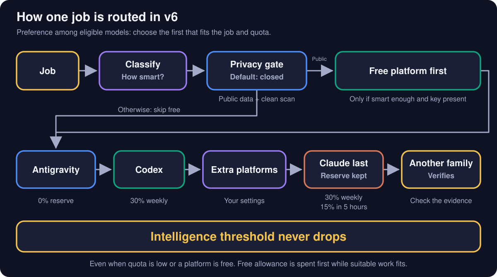
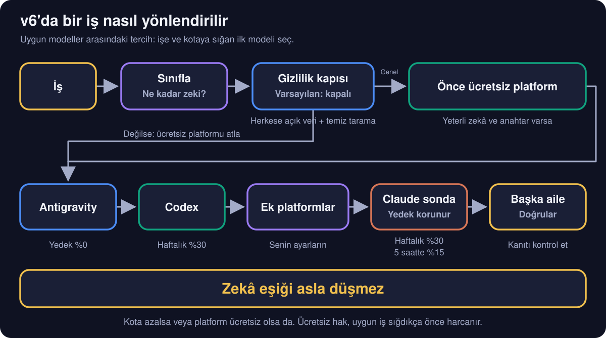

<div align="center">

# 🎼 Orkestra

**Your AI subscriptions, playing as one orchestra.**<br>
**Yapay zekâ aboneliklerin, tek bir orkestra gibi çalışsın.**

[](#-english)
[](#-türkçe)
[](https://github.com/yigityildiz0/orkestra/archive/refs/heads/main.zip)
[](https://github.com/yigityildiz0/orkestra/releases/latest)

[](#-english)
[](#-english)
[](#-english)
[](#-english)


</div>

---

## 🇬🇧 English

### The idea in 30 seconds

You pay for ChatGPT Plus. Maybe Claude too, maybe Google AI Pro. Each one has its own limits that refill every
5 hours or every week, and they are not equal: 5% of one plan is not 5% of another. Most people use one until it
runs dry, while the others sit idle.

**Orkestra turns your main AI into a conductor.** Before each piece of work it looks at how hard the job is and how
much room each subscription has left. Then it hands the job to the model that is **smart enough, but not wasteful**,
on the platform that can best afford it. A different model family checks the result. Reading the limits costs
**zero tokens**.

> **Start with just Codex.** If ChatGPT Plus is all you have, Orkestra still picks Sol, Terra or Luna and the
> right effort for each job, and keeps a weekly reserve. Add Claude, Antigravity, OpenCode or anything else later.

### 🎻 Meet the orchestra


Think of a restaurant kitchen. The head chef does not cook every dish: easy ones go to a junior cook, hard ones
to the best cook who is free right now, and someone else tastes the plate before it leaves. Orkestra is that head
chef for your AI subscriptions. The models are the cooks; their limits are their working hours.

### ⚡ Install in one minute: let your AI do it

1. Copy the message below.
2. Fill in the blanks with what you have.
3. Paste it into the AI app you already use on your computer (**Codex, Claude Code, OpenCode or Antigravity**; the ChatGPT or Claude desktop app with code access works too). It reads [`INSTALL.md`](INSTALL.md), finds what is
   really installed, fixes what is broken, and sets everything up. It asks before anything that costs money or quota.

```text
Set up Orkestra for me: https://github.com/yigityildiz0/orkestra
Read INSTALL.md there and follow it step by step. I am not technical,
so explain every step in simple words.

These are the AI subscriptions I pay for (write yes / no / not sure):
- ChatGPT Plus or Pro: ____
- Claude Pro or Max: ____
- Google AI Pro (Gemini): ____
- Something else (OpenCode Go, Kimi, DeepSeek, ...): ____

For each one I have, check whether its app for the terminal is installed on
this computer and signed in. If one is missing, ask me, then install it,
or tell me exactly what to click and type. Never use paid extras or ask for API keys
(I set a free platform's key as an environment variable myself).
When everything works, show me /orkestra and how to use it.
```

<details>
<summary><b>Prefer to do it by hand?</b></summary>

1. [Download the ZIP](https://github.com/yigityildiz0/orkestra/archive/refs/heads/main.zip) and unzip it.
2. Copy `skills/orkestra` into your tool's skills folder, for example `~/.claude/skills/orkestra` or `~/.codex/skills/orkestra`.
3. Copy `examples/platformlar.example.json` to `~/.orkestra/platformlar.json` and edit it to match your platforms.
4. Check: run `python -I skills/orkestra/scripts/kapasite.py kontrol` and `python -I skills/orkestra/scripts/evren_suru.py kontrol`. Both run offline; every check should say PASS and both commands should exit successfully.

</details>

### 🎯 How a task is routed


1. **Task**: you type `/orkestra fix the login bug`, or just work while orchestration is on.
2. **Classify**: how smart must the worker be? Mechanical, simple, research, normal, code, hard or critical.
3. **Quotas**: Codex and Antigravity limits come from their local tools, Claude's from the app. Optional EVREN uses its quota endpoint. No model is called.
4. **Score**: every model × effort pair is scored by intelligence, the real work left in each window, your pace this
   week and how expendable that platform is. A model that is too weak is dropped; a big model for a tiny job is penalised.
5. **Delegate**: the winner gets a short, precise brief. Independent pieces run in parallel.
6. **Verify**: a different model family checks the result before you see it.

### 🪫 Spend order


The picture shows subscription quota pools: each pool is a shared allowance for its models. Colour is spendable;
hatching is the reserve never spent. Defaults: Codex keeps 30% weekly; Claude keeps 30% weekly **and 15% in its
5-hour window**; Antigravity keeps 0% and is spent down to zero as long as the work fits.



A **free platform** offers a model allowance at no charge. Think of an extra kitchen prep station: use it first for
jobs its cook can handle, keeping your subscription cooks available for harder dishes. Its allowance is spent down
to zero while work fits. The intelligence threshold (how smart the model must be) never drops, in any gear, even
when quota is low or a platform is free. The order above is a preference among suitable, available models.

**EVREN is optional**, a free example of Turkey's national LLM platform. The example's free period ends on
**1 December 2026 at 03:00 Turkey time**; the pool closes then or without your own `EVREN_API_KEY`.
This is the **only exception to the no API keys rule**: you set a user environment variable yourself, following
[`INSTALL.md`](INSTALL.md#6-optional-enable-a-free-platform). The AI helper checks only whether it exists; it never
reads, prints or writes the key. The scripts use it in memory to authenticate. Codex, Claude and Antigravity
subscriptions never need API keys.

**Sending to public/free platforms is off by default:** only work you mark as public data (`--veri genel`) can go
there. A scan blocks keys, ID numbers, IBANs, cards, e-mails, health terms and secret paths; files it cannot scan,
missing or unreadable platform settings, and a project marked secret also stop sending, but the scan cannot
recognise every kind of personal information.

When Claude and GPT/Gemini models are close in intelligence, Orkestra usually prefers the alternative to save
Claude capacity (except in ultra mode). Images go to ChatGPT's image tool through Codex when available.

### ⚙️ Three gears


| Gear | When | What changes |
|---|---|---|
| `light` | you explicitly say `/orkestra light …` | cheapest model that is smart enough; at most 2 workers across paid pools; free pools are outside this cap |
| `auto` | default | light when Claude is short, ultra for critical work when Claude is plentiful, normal otherwise; no fixed worker cap: independent pieces, quota and platform concurrency decide |
| `ultra` | you explicitly say `/orkestra ultra …` | raises the intelligence requirement where possible, checks with another family; at most 6 workers across paid pools; free pools are outside this cap |

You can always just say it: *"run 4 agents"*, *"use Codex for this"*, *"don't touch Claude"*.

**New in this version:**

- **Save subscription time.** An optional free platform takes suitable public prep work first. EVREN's current models handle mechanical and simple pieces, leaving harder work to stronger models.
- **Use as many helpers as the job needs.** Auto has no fixed worker cap. Independent pieces, remaining quota and how many calls a platform accepts at once decide; free-platform pieces can wait their turn.
- **Keep moving when a platform is busy.** Retry after growing waits, pause the busy model, then try a similarly capable sibling. If the whole platform is full, route elsewhere or offer to wait; a tiny ping tests its return. Quality requirements stay the same.
- **Protect your allowance and data.** Reserves hold for whole batches. Public/free sharing starts closed, and free platforms and Antigravity stay first while suitable work still fits.
- **Follow a ready plan.** The [playbook](skills/orkestra/references/playbook.md) has 12 patterns and 41 scenarios. A watchdog is a helper that reads progress and flags trouble; other helpers check, judge, summarise, keep records or challenge an answer (`--rol`).
- **Check parallel answers before trusting them.** A swarm means several model calls on one problem. `evren_suru.py` limits any claimed gain by evidence and requires verification; today's EVREN swarm cannot replace a stronger research or coding model.

Technical details and fixes: [`CHANGELOG.md`](CHANGELOG.md).

**Auto mode:** you don't have to type `/orkestra`. For bigger jobs (subagents, several parts, long writing, images) it switches on by itself and tells you in one line which model it picked and why. It never jumps to the biggest model just because you have quota left, and never drops below what the job needs to save quota.

### 🔄 It keeps itself up to date


`/orkestra update` checks which models your CLIs really offer, researches prices, token use, effort curves,
abilities (image, video, audio) and strengths and weaknesses, has every important claim re-checked by a sceptical
agent, rewrites the model atlas and the selector, and runs the rule tests. Run it monthly or when a new model ships.

### Commands

| Type this | It does |
|---|---|
| `/orkestra` | show remaining quota and the best model for each kind of work |
| `/orkestra <task>` | do the task the orchestrated way |
| `/orkestra light <task>` / `/orkestra ultra <task>` | same, in a fixed gear |
| `/orkestra on` / `/orkestra off` | orchestrate every substantial task in this session, or stop |
| `/orkestra update` | refresh the model knowledge (see above) |
| `/orkestra why <model> <class>` | explain why a model was chosen or dropped |
| `/orkestra rol <role> <class>` | pick a helper to watch, check or summarise work |

### What works with what

| Platform | Leader | Workers | Quota read | Notes |
|---|---|---|---|---|
| Codex CLI (ChatGPT Plus/Pro) | ✅ | ✅ | automatic | image generation lives here |
| Claude Code (Pro/Max) | ✅ | ✅ | desktop app or `/usage` | protected, spent last |
| Antigravity `agy` (Google AI Pro) | ✅ | ✅ | automatic | Gemini plus its own Claude pool; video understanding in interactive mode |
| OpenCode and other headless CLIs | ✅ | ✅ | you give a rough % | add them in `platformlar.json` |
| Free API platform (example: EVREN) | – | ✅ text calls, Codex profile for edits | automatic (`/v1/quota`) | only with your own key and `--veri genel`; mechanical/simple work |

Video generation has no automatic route on these subscriptions today; Orkestra says so and tells you the manual route.

### FAQ

<details><summary><b>Does it cost anything extra?</b></summary>
No paid add-ons are enabled. Your subscriptions use their own CLIs without API keys. EVREN is an optional free example until 1 December 2026 at 03:00 Turkey time, and the only key exception: you set your own user environment variable. The AI helper checks presence only; scripts authenticate in memory. No key means the pool stays closed.
</details>
<details><summary><b>How many workers can run?</b></summary>
Auto has no fixed cap, even when it automatically chooses light or ultra behaviour. Independent pieces, quota and platform concurrency decide. Only an explicit light or ultra request caps workers across paid pools at 2 or 6; free pools queue extra pieces in waves.
</details>
<details><summary><b>Can it spend my last allowance?</b></summary>
Default reserves are Codex 30% weekly and Claude 30% weekly plus 15% in its 5-hour window. They hold in every gear and for whole batches. Antigravity and free platforms keep 0% and are spent down to zero while work fits. Unknown paid quota is assumed to be 50% and treated as twice as expensive; free quota uses a configured estimate or 80% without that penalty. Estimates do not prove the real reserve is available.
</details>
<details><summary><b>Does checking limits use tokens?</b></summary>
No model is called. Codex and Antigravity use their local tools; optional EVREN checks its quota endpoint without spending model tokens. Results are cached for 10 minutes; EVREN cooldown status is read fresh. A ping is different: it calls a model and uses a tiny allowance.
</details>
<details><summary><b>Can I force a model?</b></summary>
Yes. Say it, or add a project rule file <code>.orkestra.json</code>. Your words beat every default.
</details>
<details><summary><b>How accurate are the numbers?</b></summary>
Intelligence scores and prices come from public benchmarks (dated in the atlas). Quota costs start as estimates and
calibrate themselves with <code>olc</code> measurements. <code>/orkestra update</code> refreshes everything.
</details>
<details><summary><b>Why are the script's labels Turkish?</b></summary>
The helper scripts are read by your AI, not by you, and Orkestra was born in Turkish. Your AI answers in your language.
</details>

### 🆓 Free to use, change and share

Orkestra is [MIT licensed](LICENSE): use it at home or at work, change it, ship it in your own project, even
sell something built on it. Just keep the license file. Found a better routing rule or a new platform?
[Open an issue or a pull request](CONTRIBUTING.md). If it saves you limits, a ⭐ helps others find it.
See Claude work live: [Claude Office](https://github.com/yigityildiz0/claude-pixel-office), the sister project.

<sub>Claude, ChatGPT, Codex, Gemini, Antigravity, OpenCode, Kimi and DeepSeek are trademarks of their owners.
Orkestra is an independent community project, not made or endorsed by any of them. The model characters in the
pictures are original illustrations, not official logos.</sub>

---

## 🇹🇷 Türkçe

### 30 saniyede fikir

ChatGPT Plus'a para ödüyorsun. Belki Claude'a da, belki Google AI Pro'ya da. Her birinin 5 saatte ya da haftada bir
dolan kendi limiti var ve bunlar eşit değil: birinin %5'i ötekinin %5'i değil. Çoğu kişi birini bitene kadar
kullanır, diğerleri boşta bekler.

**Orkestra, ana yapay zekânı bir şefe dönüştürür.** Her işten önce işin ne kadar zor olduğuna ve hangi aboneliğin ne
kadar yeri kaldığına bakar. İşi, **yeterince zeki ama israf etmeyen** modele, bunu en rahat karşılayabilecek
platformda verir. Sonucu başka bir model ailesi kontrol eder. Limitleri okumak **sıfır token** harcar.

> **Sadece Codex ile başla.** Elinde yalnız ChatGPT Plus varsa Orkestra yine her iş için Sol, Terra ya da Luna'yı ve
> doğru eforu seçer, haftalık yedek bırakır. Claude, Antigravity, OpenCode ya da başka platformları sonra eklersin.

### 🎻 Orkestrayla tanış


Bir restoran mutfağı düşün. Şef her yemeği kendisi pişirmez: kolay tabak çırağa, zor tabak o an boşta olan en
iyi aşçıya gider ve tabak çıkmadan önce başka biri tadına bakar. Orkestra, yapay zekâ aboneliklerinin şefidir.
Modeller aşçılar, limitleri de mesai saatleridir.

### ⚡ Bir dakikada kurulum: yapay zekân yapsın

1. Aşağıdaki mesajı kopyala.
2. Boşlukları elindekilerle doldur.
3. Bilgisayarında zaten kullandığın yapay zekâ uygulamasına yapıştır (**Codex, Claude Code, OpenCode ya da Antigravity**; kod erişimi olan ChatGPT veya Claude masaüstü uygulaması da olur). [`INSTALL.md`](INSTALL.md) dosyasını okur, neyin
   gerçekten kurulu olduğunu bulur, bozukları düzeltir ve her şeyi ayarlar. Para ya da kota harcayacak her şeyden önce sorar.

```text
Orkestra'yı benim için kur: https://github.com/yigityildiz0/orkestra
Oradaki INSTALL.md dosyasını oku ve adım adım uygula. Teknik bilgim yok,
her adımı basit kelimelerle anlat.

Para ödediğim yapay zekâ abonelikleri (evet / hayır / emin değilim yaz):
- ChatGPT Plus veya Pro: ____
- Claude Pro veya Max: ____
- Google AI Pro (Gemini): ____
- Başka bir şey (OpenCode Go, Kimi, DeepSeek, ...): ____

Sahip olduklarımın her biri için terminal uygulaması bu bilgisayarda kurulu
ve giriş yapılmış mı kontrol et. Eksik olan varsa önce bana sor, sonra kur
ya da tam olarak nereye tıklayıp ne yazacağımı söyle. Ücretli ek kullanma; API
anahtarı isteme (ücretsiz platform anahtarını ben ortam değişkenine kendim koyarım). Her şey çalışınca bana /orkestra'yı ve nasıl kullanacağımı göster.
```

<details>
<summary><b>Elle kurmak mı istersin?</b></summary>

1. [ZIP'i indir](https://github.com/yigityildiz0/orkestra/archive/refs/heads/main.zip) ve aç.
2. `skills/orkestra` klasörünü aracının skill klasörüne kopyala; örneğin `~/.claude/skills/orkestra` veya `~/.codex/skills/orkestra`.
3. `examples/platformlar.example.json` dosyasını `~/.orkestra/platformlar.json` olarak kopyala ve platformlarına göre düzenle.
4. Kontrol: `python -I skills/orkestra/scripts/kapasite.py kontrol` ve `python -I skills/orkestra/scripts/evren_suru.py kontrol` çalıştır. İkisi de ağsız çalışır; her kontrol PASS demeli ve iki komut da başarıyla çıkmalı.

</details>

### 🎯 Bir iş nasıl yönlenir


1. **İş**: `/orkestra giriş hatasını düzelt` yazarsın ya da orkestra açıkken normal çalışırsın.
2. **Sınıfla**: işçi ne kadar zeki olmalı? Mekanik, basit, araştırma, normal, kod, zor ya da kritik.
3. **Kota**: Codex ve Antigravity limitleri yerel araçlarından, Claude'unki uygulamadan okunur. İsteğe bağlı EVREN kendi kota adresini kullanır. Hiçbir model çağrılmaz.
4. **Puanla**: her model × efor ikilisi zekâya, her penceredeki gerçek kalan işe, bu haftaki temponla ve o platformun
   ne kadar harcanabilir olduğuna göre puanlanır. Zayıf kalan model elenir; küçük işe büyük model ceza alır.
5. **Dağıt**: kazanana kısa ve net bir görev tanımı gider. Bağımsız parçalar paralel çalışır.
6. **Doğrula**: sonuç sana gelmeden başka bir model ailesi kontrol eder.

### 🪫 Harcama sırası


Resim aboneliklerin kota havuzlarını gösterir: havuz, modellerin paylaştığı kullanım hakkıdır. Renkli kısım
harcanabilir, taralı kısım hiç dokunulmayan yedektir. Varsayılanlar: Codex haftalık %30; Claude haftalık %30
**ve 5 saatlik pencerede %15** saklar. Antigravity'nin yedeği %0'dır; iş sığdığı sürece sıfıra kadar harcanır.



**Ücretsiz platform**, para ödemeden model kullanım hakkı sunar. Mutfaktaki ek hazırlık tezgâhı gibi düşün:
aşçısının yapabildiği işler önce ona gider, abonelikteki aşçıların zor yemeklere vakti kalır. İş sığdıkça bu hak
sıfıra kadar harcanır. Zekâ eşiği (modelin ne kadar zeki olması gerektiği) hiçbir viteste düşmez; kota azalsa
veya platform ücretsiz olsa da. Yukarıdaki sıra, uygun ve kullanılabilir modeller arasındaki tercihtir.

**EVREN isteğe bağlıdır**; Türkiye'nin ulusal dil modeli platformunu ücretsiz platform örneği olarak kullanır.
Örnekteki ücretsiz dönem **1 Aralık 2026 saat 03.00'te (Türkiye saati)** biter; o zaman veya kendi
`EVREN_API_KEY` anahtarın yoksa havuz kapalı kalır. Bu, **API anahtarı kullanmama kuralının tek istisnasıdır**:
[`INSTALL.md`](INSTALL.md#6-optional-enable-a-free-platform) adımlarıyla kullanıcı ortam değişkenini kendin
ayarlarsın. AI yardımcısı yalnız varlığını kontrol eder; anahtarı okumaz, yazdırmaz veya kaydetmez. Betikler
kimlik doğrulamak için bellekte kullanır. Codex, Claude ve Antigravity abonelikleri API anahtarı gerektirmez.

**Herkese açık/ücretsiz platformlara gönderim varsayılan olarak kapalıdır:** yalnız senin herkese açık veri
olarak işaretlediğin işler (`--veri genel`) gidebilir. Tarama; anahtar, kimlik numarası, IBAN, kart, e-posta,
sağlık terimi ve gizli yol bulursa gönderimi durdurur; taranamayan dosya, eksik veya okunamayan platform ayarı
ve gizli işaretli proje de gönderimi durdurur, ancak tarama her kişisel bilgi türünü tanıyamaz.

Claude ile GPT/Gemini modellerinin zekâsı yakınsa Orkestra, Claude kotasını korumak için genellikle diğerini
seçer (ultra hariç). Görseller, kullanılabiliyorsa Codex üzerinden ChatGPT'nin görsel aracına gider.

### ⚙️ Üç vites


| Vites | Ne zaman | Ne değişir |
|---|---|---|
| `hafif` | açıkça `/orkestra hafif …` dersen | yeterince zeki en ucuz model; ücretli havuzların toplamında en çok 2 işçi; ücretsiz havuzlar bu tavanın dışında |
| `otomatik` | varsayılan | Claude kıtsa hafif, iş kritik ve Claude bol ise ultra, diğer durumlarda normal; sabit işçi tavanı yok: bağımsız parçalar, kota ve platform eşzamanlılığı belirler |
| `ultra` | açıkça `/orkestra ultra …` dersen | mümkün olduğunda zekâ gereksinimini yükseltir, başka aileye doğrulatır; ücretli havuzların toplamında en çok 6 işçi; ücretsiz havuzlar bu tavanın dışında |

İstediğin zaman söyleyebilirsin: *"4 ajan çalıştır"*, *"bunu Codex'e yaptır"*, *"Claude'a dokunma"*.

**Bu sürümde yeni:**

- **Abonelik zamanından tasarruf et.** İsteğe bağlı ücretsiz platform, uygun ve herkese açık hazırlık işini önce alır. EVREN'in mevcut modelleri mekanik ve basit parçaları yapar; zor iş güçlü modellere kalır.
- **İşin gerektirdiği kadar yardımcı kullan.** Otomatikte sabit işçi tavanı yok. Bağımsız parçalar, kalan kota ve platformun aynı anda kabul ettiği çağrı sayısı belirler; ücretsiz platformdaki parçalar sırasını bekleyebilir.
- **Platform doluyken ilerle.** Giderek uzayan aralarla yeniden dene, dolu modeli dinlendir, sonra benzer güçte kardeş modeli dene. Platform tamamen doluysa başka yere yönlen veya beklemeyi öner; dönüşü küçük bir ping sınar. Kalite gereksinimi değişmez.
- **Kullanım hakkını ve verini koru.** Yedekler toplu işlerde de korunur. Herkese açık/ücretsiz paylaşım kapalı başlar; ücretsiz platformlar ve Antigravity, uygun iş sığdığı sürece önce gelir.
- **Hazır bir plan izle.** [Kılavuzda](skills/orkestra/references/playbook.md) 12 kalıp ve 41 senaryo var. Nöbetçi, ilerlemeyi okuyup sorunu bildiren yardımcıdır; diğerleri kontrol eder, hakemlik yapar, özetler, kayıt tutar veya cevaba itiraz eder (`--rol`).
- **Paralel cevaplara güvenmeden önce kontrol et.** Sürü, aynı problem için birkaç model çağrısı demektir. `evren_suru.py` zekâ artışı iddiasını kanıtla sınırlar ve doğrulama ister; bugünkü EVREN sürüsü güçlü araştırma veya kod modelinin yerini alamaz.

Teknik ayrıntılar ve düzeltmeler: [`CHANGELOG.md`](CHANGELOG.md).

**Otomatik mod:** `/orkestra` yazman gerekmez. Büyük işlerde (alt ajan, birkaç parça, uzun yazı, görsel) kendiliğinden devreye girer ve hangi modeli neden seçtiğini tek satırla söyler. Kota var diye en büyük modele atlamaz, kota azaldı diye işin gerektirdiğinin altına da inmez.

### 🔄 Kendini güncel tutar


`/orkestra güncelle`, CLI'larının gerçekte hangi modelleri sunduğuna bakar; fiyatı, token kullanımını, efor eğrilerini,
yetenekleri (görsel, video, ses), güçlü ve zayıf yanları araştırır, her önemli iddiayı şüpheci bir ajana yeniden
kontrol ettirir, model atlasını ve seçiciyi yeniden yazar ve kural testlerini çalıştırır. Ayda bir ya da yeni model
çıkınca çalıştır.

### Komutlar

| Yaz | Ne yapar |
|---|---|
| `/orkestra` | kalan kotayı ve her iş türü için en iyi modeli gösterir |
| `/orkestra <iş>` | işi orkestra yöntemiyle yapar |
| `/orkestra hafif <iş>` / `/orkestra ultra <iş>` | aynısı, sabit viteste |
| `/orkestra aç` / `/orkestra kapat` | bu oturumda her esaslı işi orkestrayla yürütür ya da bırakır |
| `/orkestra güncelle` | model bilgisini yeniler (yukarıda) |
| `/orkestra neden <model> <sınıf>` | bir modelin neden seçildiğini ya da elendiğini açıklar |
| `/orkestra rol <rol> <sınıf>` | işi izleyecek, kontrol edecek veya özetleyecek yardımcı seçer |

### Ne neyle çalışır

| Platform | Lider | İşçi | Kota okuma | Not |
|---|---|---|---|---|
| Codex CLI (ChatGPT Plus/Pro) | ✅ | ✅ | otomatik | görsel üretim burada |
| Claude Code (Pro/Max) | ✅ | ✅ | masaüstü uygulaması ya da `/usage` | korunur, en son harcanır |
| Antigravity `agy` (Google AI Pro) | ✅ | ✅ | otomatik | Gemini ve kendi Claude/GPT havuzu; video anlama etkileşimli modda |
| OpenCode ve diğer CLI'lar | ✅ | ✅ | yaklaşık % sen verirsin | `platformlar.json` ile eklenir |
| Ücretsiz API platformu (örnek: EVREN) | – | ✅ metin çağrısı, düzenleme için Codex profili | otomatik (`/v1/quota`) | yalnız kendi anahtarınla ve `--veri genel` ile; mekanik/basit iş |

Bu aboneliklerle bugün video üretiminin otomatik yolu yok; Orkestra bunu açıkça söyler ve el ile yolu gösterir.

### SSS

<details><summary><b>Ek bir ücreti var mı?</b></summary>
Ücretli ekler açılmaz. Aboneliklerin kendi CLI'larıyla, API anahtarı olmadan çalışır. EVREN, 1 Aralık 2026 saat 03.00'e (Türkiye saati) kadar ücretsiz, isteğe bağlı bir örnektir ve tek anahtar istisnasıdır: kullanıcı ortam değişkenini kendin ayarlarsın. AI yardımcısı yalnız varlığını kontrol eder; betikler bellekte kimlik doğrular. Anahtar yoksa havuz kapalı kalır.
</details>
<details><summary><b>Kaç işçi çalışabilir?</b></summary>
Otomatik mod hafif veya ultra davranışını kendisi seçse bile sabit tavan yoktur. Bağımsız parçalar, kota ve platform eşzamanlılığı belirler. Yalnız açıkça hafif veya ultra istersen ücretli havuzların toplamı 2 veya 6 işçiyle sınırlanır; ücretsiz havuzlar fazla parçaları dalga halinde sıraya alır.
</details>
<details><summary><b>Son kullanım hakkımı da harcar mı?</b></summary>
Varsayılan yedekler Codex'te haftalık %30, Claude'da haftalık %30 ve 5 saatlik pencerede %15'tir. Her viteste ve toplu işlerde korunur. Antigravity ve ücretsiz platformların yedeği %0'dır; iş sığdıkça sıfıra kadar harcanır. Bilinmeyen ücretli kota %50 varsayılır ve iki kat pahalı sayılır; ücretsiz kotada ayarlı tahmin veya %80 kullanılır, bu ceza uygulanmaz. Tahminler gerçek yedeğin bulunduğunu kanıtlamaz.
</details>
<details><summary><b>Limit kontrolü token harcar mı?</b></summary>
Hiçbir model çağrılmaz. Codex ve Antigravity yerel araçlarını kullanır; isteğe bağlı EVREN, model token'ı harcamadan kota adresini kontrol eder. Sonuç 10 dakika saklanır; EVREN'in bekleme durumu her seferinde yeniden okunur. Ping farklıdır: model çağırır ve küçük bir kullanım hakkı harcar.
</details>
<details><summary><b>Bir modeli zorlayabilir miyim?</b></summary>
Evet. Söylemen yeterli ya da projeye <code>.orkestra.json</code> kural dosyası ekle. Senin sözün her varsayılanı geçer.
</details>
<details><summary><b>Sayılar ne kadar doğru?</b></summary>
Zekâ puanları ve fiyatlar herkese açık ölçümlerden gelir (atlasta tarihli). Kota maliyetleri tahminle başlar ve
<code>olc</code> ölçümleriyle kendini düzeltir. <code>/orkestra güncelle</code> hepsini yeniler.
</details>
<details><summary><b>Betiklerin etiketleri neden Türkçe?</b></summary>
Yardımcı betikleri sen değil, yapay zekân okur; Orkestra da Türkçe doğdu. Yapay zekân senin dilinde yanıt verir.
</details>

### 🆓 Özgürce kullan, değiştir, paylaş

Orkestra [MIT lisanslıdır](LICENSE): evde ya da işte kullan, değiştir, kendi projene koy, üstüne kurduğun bir
şeyi sat bile. Yalnız lisans dosyasını koru. Daha iyi bir yönlendirme kuralı ya da yeni bir platform mu buldun?
[Issue ya da pull request aç](CONTRIBUTING.md). Limitini kurtarıyorsa bir ⭐ başkalarının da bulmasını sağlar.
Claude'un çalışmasını canlı izlemek için kardeş proje: [Claude Office](https://github.com/yigityildiz0/claude-pixel-office).

<sub>Claude, ChatGPT, Codex, Gemini, Antigravity, OpenCode, Kimi ve DeepSeek sahiplerinin markalarıdır. Orkestra
bağımsız bir topluluk projesidir; bu şirketlerden hiçbiri yapmamış ya da onaylamamıştır. Görsellerdeki model
karakterleri özgün çizimlerdir, resmî logo değildir.</sub>

<div align="center"><sub>MIT · <a href="LICENSE">LICENSE</a> · Hero illustration made with ChatGPT image generation · Ana görsel ChatGPT görsel üretimiyle yapıldı</sub></div>
